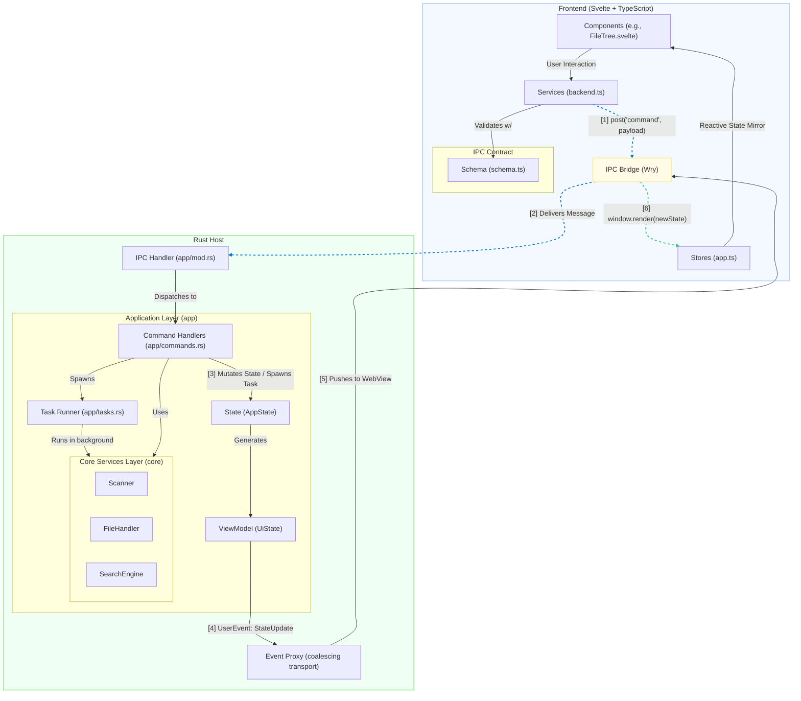

# Architecture

> **TL;DR:** This is a hybrid desktop application using a Rust host to power a web-based UI built with Svelte and TypeScript. The system is layered, featuring a decoupled core logic layer and a dedicated application layer in Rust. Communication between the host and the UI is managed through a strictly-typed, asynchronous IPC bridge. The architecture prioritizes performance, testability, and clear separation of concerns.

## Architectural Principles

This system is designed around several key principles:

- **Separation of Concerns:** The Rust backend is split into two distinct layers:
  1.  **Core Services (`src/core`):** A stateless layer holding the domain rules and the work on the file system: scanning, ignore rules, search, reading and decoding files, content generation. It reads the file system (it never writes to it) and has no knowledge of the application's state or the UI.
  2.  **Application Layer (`src/app`):** Orchestrates core services, manages the central `AppState`, handles asynchronous tasks, and communicates with the UI.
- **Unidirectional Data Flow:** User interactions in the UI trigger commands to the Rust host. The host mutates its state and then pushes a new, complete `UiState` snapshot back to the UI. The snapshot is self-contained and bounded: of the file tree it carries the rows the UI has on screen (a window of the list of all rows), and the host owns the expansion state and the list (see [IPC Contracts](./ipc.md)). The UI is a reactive reflection of the backend state, preventing inconsistencies.
- **Performance by Design:** Heavy lifting (I/O, search) is offloaded to background threads in Rust to keep the UI responsive. The file tree is windowed on both sides: the host sends only the rows around the viewport, the UI renders only the rows inside it, so neither the payload nor the DOM grows with the project. Performance budgets are enforced by CI.
- **Type Safety Across Boundaries:** The IPC bridge is defined by a strict contract using Rust structs (Serde) on the backend and Zod schemas on the frontend, eliminating an entire class of runtime errors.

## System Overview

The diagram below illustrates the main components and the two primary data flow paths: the **Command Flow** (from UI to Host) and the **State Update Flow** (from Host to UI).



---

## Architectural Layers

### Host (Rust Backend)

The backend is written in Rust and is responsible for all business logic and system interactions.

- **`src/core/*` (Core Services Layer)**

  - **Responsibilities:** Provides stateless services for the core operations. "Stateless" does not mean free of IO: scanning, the content search, the preview and the generation read the file system (blocking; callers run them off the async runtime). The rules themselves (which path is ignored, how bytes become text, how the output is laid out) are pure functions and types inside these modules, tested without IO where possible.
  - **Key Modules:**
    - `scanner.rs`: High-performance, cancellable directory traversal using the `ignore` crate. The walk is sequential and opens no file; whether the listed files are binary is found out meanwhile, on a small thread pool of its own that the walk hands the entries to in batches (opening a file is the expensive part of a scan). A scan delivers its result while it runs (`scan_in_batches`): a batch is closed after 256 entries or 100 ms (watched by a thread of its own, so a walk that is stuck in one slow directory listing still delivers what it has) and passed on, in the order of the walk, as soon as its files have been looked at. `scan` is the same with the batches collected. A cancellation stops the walk and the look at the contents; what has been delivered by then is a correct, partial listing. The scanner knows nothing about where the batches go.
    - `ignore_rules.rs`: `IgnoreRules`, the one definition of what the ignore patterns hide (gitignore syntax including negation, see [IPC Contracts](./ipc.md#ignore-pattern-semantics)). Used by the scanner, by the application layer when a pattern is added to a loaded list, and by the tree generator.
    - `file_handler.rs`: Reads files for the preview (a bounded prefix only) and the generated output, decodes them (`decode_text`: UTF-8, else Windows-1252, see [IPC Contracts](./ipc.md#file-content)) and formats the output document, including the markers for files that cannot be embedded. It also tells the size of a document beforehand, from the sizes of the scan (`estimate_output_size`), and builds no document beyond the limit it is given.
    - `token_counter.rs`: Counts the tokens of a text (`cl100k_base`): the encoder is built once, the text is borrowed, and the count is cancellable (see [IPC Contracts](./ipc.md#the-generated-output)).
    - `search.rs`: `SearchEngine` / `FileNameMatcher` filter the file list in memory (name, extension); `ContentSearch` reads the files to search their content, decoded by the same rule and within the configured size limit.
    - `tree_generator.rs`: Generation of ASCII directory trees.
  - **Characteristics:** Fully decoupled from the application. It receives its input as parameters (paths, patterns, limits such as the configured file size limit), and returns a result or an error (`CoreError`). It has no concept of application state and keeps none of its own.

- **`src/app/*` (Application Layer)**

  - **Responsibilities:** Acts as the central nervous system. It orchestrates Core services, manages state, and serves as the bridge to the UI.
  - **Key Modules:**
    - `state.rs`: Defines the single source of truth, `AppState`. It also owns the lifecycle of the running scan and generation: `begin_scan()` / `begin_open()` / `begin_generation()` hand out a `ScanToken` / `GenerationToken`, and a task may only publish results while its token is still the current one. A finished generation leaves its document here (`GeneratedDocument`), so that it can be saved without the UI sending it back. It is also where the results of a scan become the file list: the first level (`replace_with_shallow_file_list`), the batches of the walk (`merge_scanned_items`), levels loaded on demand (`merge_directory_level`) and the completion (`complete_scanned_file_list`), each guarded by the token of the work it belongs to and free of duplicates (see [Scanning](#scanning)). The file list and the filtered list are private and held as `Arc`s: they are read through getters, and every change of the file list goes through a method that gives it a new revision (`file_list_revision`), so that work that was prepared for one list without the lock can tell whether the list is still that one (`install_file_lists`, see `staged.rs`). Where the filters let everything through, the filtered list is the file list itself, the same allocation. `AppState::default()` is pure (default configuration, bound to no file); the application builds its state with `AppState::new(config, config_store)` in `main.rs`.
    - `shared_state.rs`: `SharedState`, the handle through which threads share the `AppState`, and the only place that locks it. Its `lock()` cannot fail: a lock poisoned by a panic is taken over (see [Panics](#panics)).
    - `ipc.rs`: What the UI posts. `Command` is the contract: one enum with a variant per command that carries its payload, so reading a message into it validates the message and decides what runs with which payload. `IpcMessage::parse` takes the number off the envelope and tells a command from a message that is refused (see [IPC Contracts](./ipc.md#messages-that-are-refused)).
    - `mod.rs`: `dispatch_ipc_message` / `dispatch_dropped_path`, `Command::into_work` (the one place that binds a command to its handler and its lane), and `handle_user_event`, which turns a `UserEvent` into its `window.*` call.
    - `dispatch.rs`: `CommandDispatcher`, which decides _when_ a command runs: in arrival order on the ordered lane, dialog commands on the blocking lane (see [Command ordering](./ipc.md#command-ordering)). It knows nothing about individual commands.
    - `correlation.rs`: Which snapshot answers which command. The UI names its commands (a session and a running number); `CommandProgress` is told by the ordered lane how far it has got, and `Correlated`, the proxy the commands send their events through, writes that name into every snapshot (`last_processed_session`, `last_processed_seq`, see [Commands and their snapshots](./ipc.md#commands-and-their-snapshots)). A concern of the transport: neither the commands nor the view model know about it.
    - `snapshot.rs`: `Snapshot`, what `UserEvent::StateUpdate` carries, and `send_snapshot`, the only way to build and send one: from the locked state, in one step. So snapshots are sent in the order they are made, which the coalescing of the transport and the correlation rely on.
    - `commands.rs`: Contains all functions callable by the UI via IPC, each taking its payload as the type its command carries. Together with the tasks they start, these are the functions that mutate `AppState`.
    - `filtering.rs`: Applies the filters to the file list and expands the directories of matches. State changes that go with filtering live here, not in the view model. `FilterInputs` is everything the filters make their result of apart from the list, taken out of the state: with it the filters run without the state (and without the lock on it), and it tells afterwards whether a result still belongs to the state. `apply_filters` goes the same way, so there is one definition of what the filters do.
    - `staged.rs`: The events that change the file list of a large project while the user works in it (the items of a scan's walk, the end of the walk, a level loaded on demand, the matches of a content search), each in three steps of which the expensive one holds no lock, see [Scanning](#scanning).
    - `selection.rs`: The one definition of how selected files add up to the selection state of the directories above them, and of the order in which selected files are processed. Used by the view model, the commands and the generation. `SelectedFiles` is the set of selected paths with a journal of its single changes; `SelectionCountsCache` keeps the number of selected files below every directory and follows that journal, so a click on a checkbox costs the directories above the file, not a count of the tree. The counts of a list that only grew are made from the ones before (`DirectorySelection::extended`), at the cost of what was appended.
    - `tree_index.rs`: The hierarchy of the filtered file list (children, names, counters, the number of files below each directory, a lookup of an item by its path), built once per filtered list and cached by `AppState`. Shared by the view model, the selection and the commands that act on a subtree. `IndexedList` is a list together with its hierarchy, for building the two outside the state.
    - `tracked.rs`: `Tracked<T>`, a value with a revision that changes whenever it is borrowed mutably. `AppState::expanded_dirs` is one, which is how the row list knows when it is outdated.
    - `tasks.rs`: Encapsulates long-running, asynchronous operations (like scanning or file search) that are spawned into background threads to avoid blocking. It uses traits for dependency injection, making it highly testable. It does not depend on the view model beyond producing the snapshot it sends.
    - `view_model/`: Transforms the internal `AppState` into the serializable `UiState` that is sent to the frontend. It only reads the state. `rows.rs` owns the view of the tree: the list of all rows (`VisibleRows`: every item whose ancestors are expanded, in display order, built on top of the cached `tree_index.rs` and cached until the file list or the expansion changes), the window of it the UI looks at (`Viewport`), the rows of that window as they are sent (`TreeRow`), and the lookup of a row the UI does not hold (`locateRow`). The little state this needs (`TreeViewState`: viewport, last lookup, the cached list) is hosted by `AppState`. `status.rs` words the status line; `ui_config.rs` is the view of the configuration; `lossy_path.rs` writes paths so that a file name that is not valid Unicode cannot make a snapshot unserializable.
    - `proxy.rs` & `transport.rs`: `EventProxy` is the only thing business code knows about event delivery. The production implementation in `transport.rs` queues events for the tao event loop in order and coalesces back-to-back state snapshots (latest wins), so a slow UI thread never has to serialize stale snapshots.
    - `events.rs`: Defines the `UserEvent` enum (Host → UI) and `IpcMessage` struct (UI → Host), which form the IPC contract.
    - `file_dialog.rs`: `DialogService`, the native dialogs behind a trait, so that the dialog commands can be tested. The production implementation parents the dialogs to the application window (it is handed the window's raw handles by `main.rs`; the trait knows no window types).
    - `window_geometry.rs`: The geometry of the window, a concern of the composition root (`main.rs`) and of nothing else: `WindowGeometry` tracks size and position in logical units (the event loop owns it), `GeometryStore` keeps it in `window.json` beside the configuration file and takes over, once, the geometry an older version kept in the configuration file (converting what was stored in physical pixels). Neither `AppState` nor `AppConfig` knows about it.

- **`src/utils/*` (Helpers without state)**

  - `file_detection.rs`: Tells text files from binary ones: `is_binary`, the one rule that the scan, the preview, the content search and the generation apply (see [IPC Contracts](./ipc.md#file-content)).
  - `language.rs`: Maps a file to the language its preview is highlighted as.

- **`src/config/*` (Configuration)**

  - `mod.rs`: `AppConfig`, the persisted settings, and the rules a stored value has to meet when it is read (the file size limit is at least 1 MiB). A field that a file does not name has its default (`#[serde(default)]`), so files of older versions keep loading without a list of fields to maintain.
  - `shared.rs`: `SharedConfig`, the view of the configuration that is meant to be passed on (settings, no directories) and the format of an exported file; `ImportedConfig`, what an import reads (an exported file or a complete configuration file).
  - `settings.rs`: Reading and writing a configuration file at a given path (written atomically: temporary file, then rename), import/export, and `default_config_path()`, the one function that decides where the application's own file lies (called by `main.rs` only).
  - `store.rs`: `ConfigStore`, the one way the configuration file is written while the application runs, see [Configuration persistence](#configuration-persistence).

- **`src/platform/*` (Platform and WebView policy, part of the binary)**

  - `ipc.rs`: `accepted_message`, the gate every IPC message passes before it is parsed.
  - `origin.rs`: `AppOrigin`, the origin the UI is served from in the form the web engine reports it, and `is_own_page`, which tells the UI's own documents from everything else.
  - `navigation.rs`: What happens with a navigation: the UI itself is loaded, web links go to the system browser, everything else is blocked.
  - `csp.rs`: The content security policy of the embedded UI.
  - `asset_protocol.rs`: The responses of the custom protocol, which carry that policy.
  - `macos/`: The native menu.

  All of these are pure functions of a URL or an origin, tested without a WebView; `main.rs` only wires them to wry. See [Security of the WebView](#security-of-the-webview).

---

### Frontend (Svelte + TypeScript)

The frontend is a Single Page Application (SPA) responsible for all rendering and user interaction.

- **`src/ui/src/lib/ipc` & `src/ui/src/lib/services` (IPC & Services Layer)**

  - **Responsibilities:** Manages all communication with the Rust host.
  - `schema.ts`: Uses **Zod** to define runtime-validated schemas for all incoming and outgoing IPC messages. This creates a robust, self-documenting contract that prevents malformed data from crossing the boundary.
  - `handlers.ts`: Defines global `window.*` functions that are called by the Rust host to deliver events (e.g., `window.render(newState)`). These handlers validate incoming data against the Zod schemas before processing.
  - `backend.ts`: Provides a strongly-typed `post(command, payload)` function for sending commands to the host. It names the commands (the session of this load of the UI and a running number) and returns the name; a snapshot that names the session and has reached the number accounts for the command. In development mode, it validates outgoing payloads against the Zod schemas.

- **`src/ui/src/lib/stores` (State Management Layer)**

  - **Responsibilities:** Holds the client-side state.
  - `app.ts`: Contains the main `appState` Svelte store, which acts as a reactive mirror of the `UiState` from the backend.
  - `uiStores.ts`: Contains derived stores that compute UI-specific flags (e.g., `canGenerate`, `isBusy`) from the base `appState`. This simplifies component logic.

- **`src/ui/src/lib/components` (Presentation Layer)**

  - **Responsibilities:** A collection of reusable Svelte components that render the application state.
  - `FileTree.svelte`: Renders the rows of the tree the host has sent for the current viewport, reports the viewport to the host when it moves (`setViewport`), and handles the keyboard. It holds a window of the rows, never the tree; see [Virtualization Patterns](./virtualization.md). The arithmetic of the window (`$lib/modules/treeWindow.ts`) is separate and has no state.

---

## Key Architectural Patterns

- **State Management:** The application employs a robust, centralized state management pattern.

  1.  The Rust host owns the canonical `AppState`.
  2.  UI actions dispatch commands that mutate this `AppState`.
  3.  After mutation, a new `UiState` view model is generated and pushed to the UI.
  4.  The UI's Svelte store is updated, causing the Svelte components to reactively re-render.
      This unidirectional flow makes the system predictable and easier to debug.

- **Asynchronous Task Handling:** Long-running operations are defined in `app/tasks.rs` and executed via `tokio::spawn` (blocking work via `spawn_blocking`). This prevents the main thread from blocking. Each run is identified by a token (`ScanToken`, `GenerationToken`, see `state.rs`) that carries its cancellation flag; cancelling or starting a new run invalidates the old token, so a superseded task can neither be mistaken for the current one nor overwrite newer state.

- **Configuration persistence:** <a id="configuration-persistence"></a>The configuration is edited in memory, under the state lock, and written outside of it. Every save goes the same way: the code that changed the configuration takes a numbered snapshot while it still holds the lock (`AppState::config_snapshot`), and the snapshot is written later, normally on the blocking thread pool (`tasks::save_config_in_background`). `ConfigStore` serializes the writes and skips a snapshot once a newer one has been written, so saves that overtake each other cannot leave older content on disk. The save at exit (`ConfigStore::close`, called by `main.rs` when the event loop ends) writes the most recent snapshot itself if it is not on disk yet, and closes the store: a save that is still queued can neither overtake it nor run after it. It does not ask for the application state (every change has taken its snapshot), so quitting never waits behind a worker that holds the state lock. Nothing else writes the file. The geometry of the window is not part of the configuration: the composition root keeps it in a file of its own (`window_geometry::GeometryStore`, `window.json`), so the two saves have nothing to do with each other. Unit tests work with a state that is bound to no file (`ConfigStore::detached`), or with a store on a file in a temporary directory.

- **Scanning:** <a id="scanning"></a>A scan (`tasks::scan_phases`) shows a usable tree at once and fills it while it runs. The division of labour: the scanner streams domain results, the task decides when they are published, the state merges them, the view model only reads.
  1. **First level.** One directory listing of the root (`ScanRequest::project(root, Some(1))`), published as soon as it is there. The walk of the `ignore` crate is depth-first, so a single walk could only show the first level after it has been through the whole first subtree; the price of the extra phase is one directory read.
  2. **The walk of the whole project**, once. Its batches arrive through a channel and are published by `BatchPublisher`: merged into the file list, the filters applied, a snapshot sent. The walk lists the first level again; those items (and levels the user loaded meanwhile) are known as being ahead of the walk and are not added twice.
  3. **Completion.** When the walk has ended, the list is declared complete (`is_fully_scanned`, all directories loaded, the active ignore patterns of the walk); an item that was listed ahead of the walk and that the walk did not find is removed, so the complete list is exactly what the walk saw. Then the content search is repeated and the scan reported as finished.

  **Exploring during the scan.** A directory the walk has not completed is not marked as loaded (`children_loaded: false`), and expanding it loads its level right away (`loadDirectoryLevel`, one directory listing), whether or not a scan is running. A level that is loaded right after a re-scan was started, before its first level is there, is kept when that first level replaces the list. A scan that is cancelled keeps what it has published.

  **Bounded cost of publishing.** Publishing works on the whole list (the filtered list, the tree index), so its cost grows with the list. Two things keep that from being felt.

  _The pace._ Batches are published together, at most every 150 ms and only after nine times the duration of the previous publication has passed: publishing takes about a tenth of the scan's time, whatever the size of the project. Measured on macOS (16 cores, warm cache) with 200,000 files in 8,040 directories, half of them without a telling extension: first level after 3 ms (before and after); first entries below it after 0.16 s (before: 2.26 s, at the end of the scan); scan complete after 2.2 s (before: 2.26 s); 6 publications of 9 to 120 ms each, 0.28 s in total. The walk is not parallel (`build_parallel`): on that tree it accounts for 0.55 s of the 2.2 s and already overlaps with the look at the contents, which decides the total.

  _The lock._ Every command waits while the state is locked, and so does the walk, which reports its progress every 100 ms. The events that change the list of a large project are therefore brought into the state in three steps (`staged.rs`, driven by `tasks::in_three_steps`), of which only the first and the last hold the lock:
  1. _Stage (locked):_ what the work needs is taken out of the state: the file list (a shared handle, no copy), its revision and the inputs of the filters (`FilterInputs`), and what the event brings. For a batch of the walk, the items that are not listed yet are told from the ones that are. Nothing else changes.
  2. _Prepare (not locked):_ the new file list, the filtered list and its tree index are built (`IndexedList`). Without an active filter the filtered list is the file list itself, so there is one list to build. An event that leaves the file list and the filters as they are (a batch whose items are all listed already, a walk that ends with nothing to remove, a level that brings nothing new) builds nothing, with a filter as without one: the lists stay, with their revisions, the tree index and the selection counts. That is not assumed either: the state records which filters its filtered list was made with, out of which revision of the file list (`AppState::filters_of_filtered_list`), and nothing is built only if the filters of the event make the same of a list as those (`FilterInputs::filters_like`). A filtered list that was set in any other way, or whose filters have changed since without being applied, is made anew.
  3. _Commit (locked):_ the lists are installed together with the index, and the snapshot is made, under the same lock, from the state as it is then: a snapshot shows exactly the state.

  Four events go this way: a publication of the walk's items, the end of the walk (completion), a level loaded on demand, and the matches of a content search.

  Between steps 1 and 3 the state is consistent (the event has not happened yet) and anything may happen to it. What was prepared is therefore installed only if the state is still the one it was prepared for, and none of that is assumed:
  - **The token.** The scan, the lazy load or the content search has to be the current one, in step 1 and again in step 3. If it is not, nothing is changed and nothing sent, as before.
  - **The file list.** It has to have the revision it had in step 1. The list is private to `AppState`, and every method that changes it gives it a new revision, whatever the change is: a list of the same length, or an equal one, is another list.
  - **The filtered list.** It has to have the revision it had, and to be (or not to be) the file list as it was. "Is the file list" is the identity of the two `Arc`s, not a comparison.
  - **The filters.** Their inputs have to be the ones of step 1: the root path, the filter texts, case sensitivity, the removal of empty directories, whether the list is complete, the directories that are loaded (where empty directories are removed from a complete list), and the matches of the content filter, which are the same only if they are the same set (the state gets a new one whenever they are replaced). Every input is compared, because none of them is tied to a revision of the lists: the path changes when a re-scan is started, case sensitivity with the configuration, and the list stops being complete when the walk of a scan begins, each while the lists stay as they are. The loaded directories are the one input that nothing changes on its own today where they are compared (a level that is merged gives the file list a new revision, the end of a walk is followed by the filters under the same lock); they are compared all the same, because `loaded_dirs` is a public field and only those call sequences tie it to a revision.

  If any of the last three does not hold, what was prepared is dropped, and nothing has happened. The event is not made under the lock then: step 3 stages it again, for the state as it is (`Committed::Again`; for a batch, the items that have been listed meanwhile are told from the others once more), and steps 2 and 3 are repeated. Only an event that finds the state changed a second time takes the plain way under the lock (the methods of `AppState`, then `apply_filters`), as every event used to; the result is the same. It is one more attempt and not a loop, so that a state that keeps changing cannot keep an event from happening. A test plays 20,000 random sequences of events and commands against that plain way, with commands between the steps of an event and again while it is prepared the second time (`events_in_steps_end_like_events_under_one_lock`); removing any one of the comparisons above makes it fail. Lists and indexes that have been replaced are dropped after the lock has been released (`Discarded`); that also goes for the lists a re-scan replaces with its first level.

  What is left under the lock, exactly:
  - In step 1: a hash lookup per item of a batch (is it listed ahead of the walk?); for the other events nothing that grows. If empty directories are removed, the set of loaded directories is copied (in step 1) and compared (in step 3).
  - In step 3: moving the handles; for a completion, deselecting what is no longer listed, which costs what was selected since step 1 (the selection of step 1 is checked against the list in step 2, on a snapshot of it). If the state has changed, what step 1 does, once more.
  - The snapshot: the list of rows is built anew (in proportion to the rows, i.e. to what is expanded), and the selection counts are brought up to date. For a list that only grew (a batch or a level without an active filter) they are extended by the appended files that are selected; otherwise they are counted anew (in proportion to the selected files, or to the filtered list if most of it is selected).

  Measured on the same machine with a synthetic list, release build (`cargo test --release --lib perf_lock_hold -- --ignored --nocapture`). The longest lock of the event, snapshot included; in brackets the same event under one lock (the change, the filters, the snapshot), which is what it used to be:

  | Longest lock                                      | 200,000 listed          | 1,000,000 listed        |
  | ------------------------------------------------- | ----------------------- | ----------------------- |
  | **No filter**                                     |                         |                         |
  | Publication of 4,096 items                        | 0.2 ms (46–53 ms)       | 0.2 ms (241–261 ms)     |
  | Publication of a tenth of the list                | 1.1–1.2 ms (48–73 ms)   | 4.1–4.5 ms (296–402 ms) |
  | Level loaded on demand                            | ≤ 0.1 ms (52–54 ms)     | 0.1 ms (265–294 ms)     |
  | Matches of a content search                       | 0.8–0.9 ms (39–43 ms)   | 5.9–6.6 ms (213–227 ms) |
  | Completion                                        | < 0.1 ms (0.9 ms)       | < 0.1 ms (4.2 ms)       |
  | **File name filter** (a fifth of the files)       |                         |                         |
  | Publication of 4,096 items                        | 0.2 ms (93–105 ms)      | 0.2 ms (472–552 ms)     |
  | Publication of a tenth of the list                | 0.9–1.1 ms (100–133 ms) | 4.0–4.6 ms (511–739 ms) |
  | Level loaded on demand                            | ≤ 0.1 ms (97–100 ms)    | 0.1 ms (511–514 ms)     |
  | Matches of a content search                       | 0.6–0.7 ms (49–53 ms)   | 2.8–3.8 ms (249–283 ms) |
  | Completion                                        | < 0.1 ms (96 ms)        | < 0.1 ms (494–508 ms)   |
  | **Every directory expanded, every file selected** |                         |                         |
  | Publication of 4,096 items                        | 2.1–2.4 ms (61–75 ms)   | 7.5–9.1 ms (390–443 ms) |
  | Publication of a tenth of the list                | 6.3–7.7 ms (71–111 ms)  | 37–43 ms (462–722 ms)   |
  | Level loaded on demand                            | 1.2 ms (72–79 ms)       | 6.0–6.5 ms (436–474 ms) |
  | Matches of a content search                       | 4.6 ms (41–47 ms)       | 28–29 ms (259–262 ms)   |
  | Completion                                        | 0.1 ms (56–75 ms)       | 0.1 ms (573–601 ms)     |
  | **Empty directories removed**                     |                         |                         |
  | Completion                                        | 0.1 ms (90 ms)          | 0.3 ms (631–673 ms)     |
  | **First level of a re-scan** (any of the above)   | ≤ 0.1 ms (4–6 ms)       | ≤ 0.2 ms (21–33 ms)     |

  The work itself has not become less: a publication as a whole takes 47–67 ms at 200,000 and 240–450 ms at 1,000,000 entries without a filter (twice that with one), which is what the pace follows. It runs on the task of the event, beside the commands. The exception is the event that brings nothing: the completion of a walk under a file name filter, which used to build the filtered list and its index once more beside the commands (about 95 ms and 500 ms), builds nothing.

  Not covered by the steps, i.e. still under one lock for work on the whole list:
  - Commands that filter (`updateFilters`, a changed ignore pattern or option, clearing a filter): they run on the ordered lane and hold the lock for the filtering and the snapshot, about the bracketed times of "Level loaded on demand" above. The user who typed waits for exactly that; nothing else does that could not wait.
  - An event whose state changed between its steps and again while it was prepared the second time (the plain way, see above): that takes two commands that change the lists or the filters within one event, and is then as before.
  - Starting a generation copies the file list for the plan (`GenerationPlan::of`).

- **Panics:** <a id="panics"></a>A panic in a command or a background task is isolated, in debug and in release builds alike (the release profile uses `panic = "unwind"`; with `abort` none of the following would exist at run time). The dispatcher catches a panicking command (`dispatch.rs`), Tokio catches a panicking task, and the guards in `tasks.rs` release the scanning/generating state of a task that ended that way (the guard of a scan covers its whole task, from the first look at the path). A content search whose worker panics is reported with `showError` and leaves the previous matches in place. A panic while the state lock is held poisons the mutex; `SharedState::lock()` takes such a lock over, logs the incident once and clears the mark, so one failed command does not make every later one fail. The state is plain data, so this is sound; the command that panicked may have left its own change incomplete. A panic on the UI thread itself (the event loop) still ends the application.

- **Testing and Quality Gates:**

  - **Unit Tests:** `cargo test` runs the Rust tests (`#[cfg(test)]`), Vitest the TypeScript tests (`*.test.ts`). The backend's use of traits (`Scanner`, `FileSearcher`, etc.) allows for mocking dependencies and deterministic testing of task logic. The tests of the large modules of the application layer are files of their own, grouped by topic: `src/app/tasks/tests/`, `src/app/commands/tests/`, `src/app/state/tests/` and `src/app/tests/` (dispatch); `mod.rs` of each holds what its topics share. What the tests of the application layer are built from is one module, `src/app/test_support.rs` (compiled for tests only): a mock `EventProxy` with the stream of its events (`event_channel`, `EventStream`), a project in a temporary directory (`TempProject`), dialogs that answer what a test tells them to (`MockDialogService`), and `TestHarness`, which puts them together around a shared state. The integration tests (`tests/`) see the public API only and keep a small harness of their own.
  - **Contract Tests (`src/ui/src/tests/contracts`):** These tests validate the Zod schemas against expected valid and invalid payloads, pin their JSON-schema form with committed snapshots, and parse a `UiState` fixture written by the Rust contract test (`src/app/view_model/contract_tests.rs`) as well as the command fixture written from the host's routing table, ensuring both sides of the IPC contract stay in sync in both directions. A third fixture is a scenario of the row windowing recorded from the host's commands; it is replayed against the model of the host that the UI's tests use where there is no host (`$lib/dev/treeHostModel.ts`).
  - **E2E Tests (`src/ui/e2e`):** Playwright tests cover critical user flows, accessibility (`a11y`), and performance.
  - **Performance Budgets:** The project enforces strict budgets for both bundle size (Brotli-compressed assets) and interaction performance (e.g., rendering a 25k-node tree), which are checked in CI. On the host, `snapshot_of_a_huge_expanded_project_is_bounded_by_the_window` (`src/app/view_model/windowing_tests.rs`) holds the size of a snapshot and the cost of a click and of scrolling for 500,000 expanded files.

## Security of the WebView

The WebView shows the application's own UI and nothing else. Four policies in `src/platform` keep it that way; each is a pure function, and `main.rs` is the only place that connects them to wry.

| Policy                  | Where                                 | What it does                                                                                                                                                                                                          |
| ----------------------- | ------------------------------------- | --------------------------------------------------------------------------------------------------------------------------------------------------------------------------------------------------------------------- |
| Content security policy | `csp.rs`, sent by `asset_protocol.rs` | A `Content-Security-Policy` header on every response of the `cfc` protocol (the document, the scripts, the workers; a 404 too). The header is the single source of truth: there is no `<meta>` policy in `index.html` |
| IPC origin              | `ipc.rs`, `origin.rs` (`is_own_page`) | A command is only taken from a document of the UI's own origin; anything else is logged and dropped                                                                                                                   |
| Navigation              | `navigation.rs`                       | Only the UI's origin and `about:` are loaded; `http(s)` links open in the system browser; `data:`, `blob:`, `file:` and everything else are blocked                                                                   |
| Downloads               | `main.rs`                             | Denied                                                                                                                                                                                                                |

The policy of a release build (macOS and Linux; on Windows, where the origin is `http://cfc.index.html`, the `cfc:` sources are left out):

```text
default-src 'none'; script-src 'self' cfc:; style-src 'self' cfc: 'unsafe-inline'; img-src 'self' cfc: data:; font-src 'self' cfc:; connect-src 'self' cfc:; worker-src 'self' cfc:; object-src 'none'; base-uri 'none'; form-action 'none'; frame-ancestors 'none'
```

- Scripts and workers come from the bundle only: no inline script, no `eval`, no `blob:` worker (the Monaco workers are files of the bundle, handed to Monaco through `getWorker`). This is why the early theme script is a file (`src/ui/public/theme-init.js`) and not an inline script of `index.html`; a test in `csp.rs` fails if an inline script is added.
- `style-src` allows inline styles because Monaco creates `<style>` elements and style attributes at run time.
- `img-src` allows `data:` for the icons embedded into the style sheets. `connect-src` is limited to the UI's own files (Vite's preload helper fetches chunks); the UI talks to the host through IPC, not through the network.
- The dev build loads the UI from the Vite dev server, which needs inline scripts and a WebSocket for hot reloading, and carries no policy. The IPC origin check applies there as well (origin `http://localhost:1420`).

What the UI may ask the host for is limited on the host side too: `loadFilePreview` reads entries of the loaded list only, `loadDirectoryLevel` scans listed directories only, and no path of a command is trusted to lie inside the loaded directory because it starts with it (see [IPC Contracts](./ipc.md#paths-the-ui-sends)).

---

## Extending the System

Adding a new feature typically follows this sequence:

1.  **Core Logic:** Add or extend a function in a `src/core` module if new domain logic is required. A rule that more than one place needs (as the ignore rules or the text decoding) is defined there once.
2.  **Host Command:** Add the command with the type of its payload to `Command` in `src/app/ipc.rs` and its handler to `src/app/commands.rs`, which calls the core logic and mutates the `AppState`; the compiler asks for the rest (see [Changing the contract](./ipc.md#changing-the-contract)).
3.  **IPC Contract:** Describe the command's name and payload shape in `$lib/ipc/schema.ts`.
4.  **UI Action:** Call the new command from the UI using the `post()` service in `$lib/services/backend.ts`.
5.  **State & UI:** Update Svelte stores and components to handle any new state information pushed from the backend.
6.  **Testing:** Cover the new logic with Rust unit tests, TypeScript unit tests, and potentially a Playwright E2E test.
