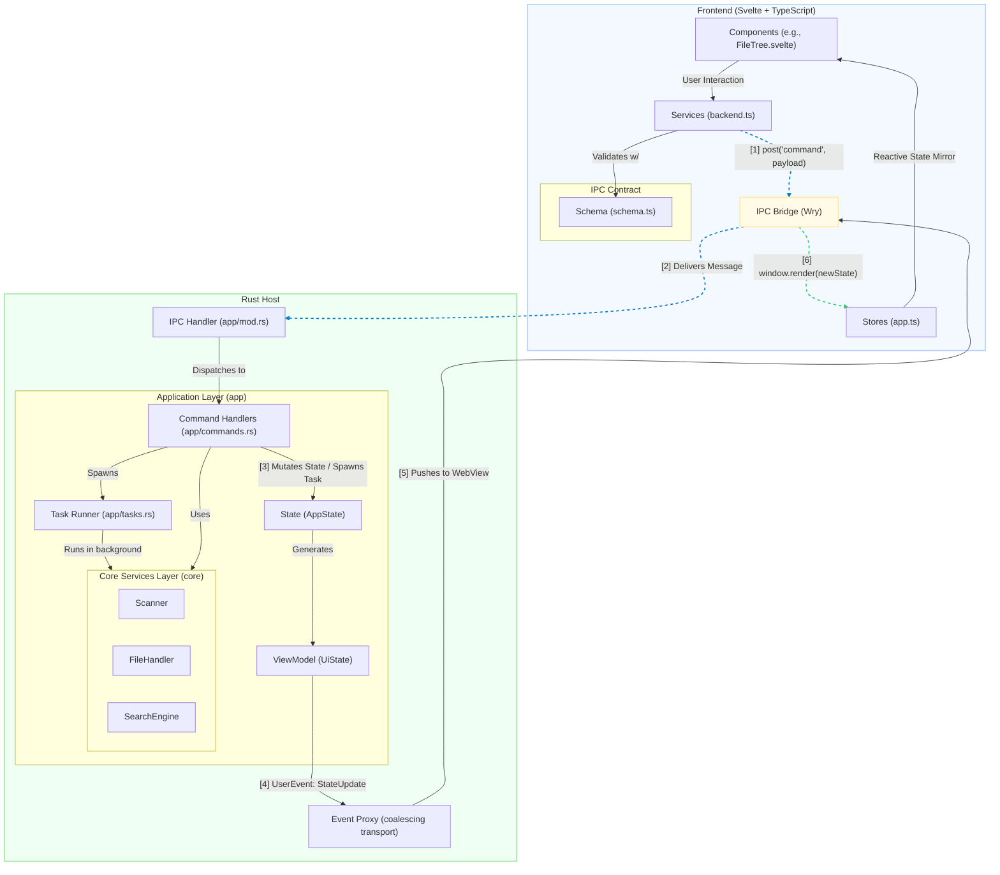

# Architecture

> **TL;DR:** This is a hybrid desktop application using a Rust host to power a web-based UI built with Svelte and TypeScript. The system is layered, featuring a decoupled core logic layer and a dedicated application layer in Rust. Communication between the host and the UI is managed through a strictly-typed, asynchronous IPC bridge. The architecture prioritizes performance, testability, and clear separation of concerns.

## Architectural Principles

This system is designed around several key principles:

- **Separation of Concerns:** The Rust backend is split into two distinct layers:
  1.  **Core Services (`src/core`):** A stateless layer holding the domain rules and the work on the file system: scanning, ignore rules, search, reading and decoding files, content generation. It reads the file system (it never writes to it) and has no knowledge of the application's state or the UI.
  2.  **Application Layer (`src/app`):** Orchestrates core services, manages the central `AppState`, handles asynchronous tasks, and communicates with the UI.
- **Unidirectional Data Flow:** User interactions in the UI trigger commands to the Rust host. The host mutates its state and then pushes a new, complete `UiState` snapshot back to the UI. The snapshot is self-contained but pruned: the tree only contains the children of expanded directories, and the host owns the expansion state (see [IPC Contracts](./ipc.md)). The UI is a reactive reflection of the backend state, preventing inconsistencies.
- **Performance by Design:** Heavy lifting (I/O, search) is offloaded to background threads in Rust to keep the UI responsive. The frontend employs virtualization to efficiently render large file trees, with performance budgets enforced by CI.
- **Type Safety Across Boundaries:** The IPC bridge is defined by a strict contract using Rust structs (Serde) on the backend and Zod schemas on the frontend, eliminating an entire class of runtime errors.

## System Overview

The diagram below illustrates the main components and the two primary data flow paths: the **Command Flow** (from UI to Host) and the **State Update Flow** (from Host to UI).



---

## Architectural Layers

### Host (Rust Backend)

The backend is written in Rust and is responsible for all business logic and system interactions.

- **`src/core/*` (Core Services Layer)**

  - **Responsibilities:** Provides stateless services for the core operations. "Stateless" does not mean free of IO: scanning, the content search, the preview and the generation read the file system (blocking; callers run them off the async runtime). The rules themselves (which path is ignored, how bytes become text, how the output is laid out) are pure functions and types inside these modules, tested without IO where possible.
  - **Key Modules:**
    - `scanner.rs`: High-performance, cancellable directory traversal using the `ignore` crate. The walk is sequential and opens no file; whether the listed files are binary is found out meanwhile, on a small thread pool of its own that the walk hands the entries to in batches (opening a file is the expensive part of a scan). A scan delivers its result while it runs (`scan_in_batches`): a batch is closed after 256 entries or 100 ms (watched by a thread of its own, so a walk that is stuck in one slow directory listing still delivers what it has) and passed on, in the order of the walk, as soon as its files have been looked at. `scan` is the same with the batches collected. A cancellation stops the walk and the look at the contents; what has been delivered by then is a correct, partial listing. The scanner knows nothing about where the batches go.
    - `ignore_rules.rs`: `IgnoreRules`, the one definition of what the ignore patterns hide (gitignore syntax including negation, see [IPC Contracts](./ipc.md#ignore-pattern-semantics)). Used by the scanner, by the application layer when a pattern is added to a loaded list, and by the tree generator.
    - `file_handler.rs`: Reads files for the preview (a bounded prefix only) and the generated output, decodes them (`decode_text`: UTF-8, else Windows-1252, see [IPC Contracts](./ipc.md#file-content)) and formats the output document, including the markers for files that cannot be embedded.
    - `search.rs`: `SearchEngine` / `FileNameMatcher` filter the file list in memory (name, extension); `ContentSearch` reads the files to search their content, decoded by the same rule and within the configured size limit.
    - `tree_generator.rs`: Generation of ASCII directory trees.
  - **Characteristics:** Fully decoupled from the application. It receives its input as parameters (paths, patterns, limits such as the configured file size limit), and returns a result or an error (`CoreError`). It has no concept of application state and keeps none of its own.

- **`src/app/*` (Application Layer)**

  - **Responsibilities:** Acts as the central nervous system. It orchestrates Core services, manages state, and serves as the bridge to the UI.
  - **Key Modules:**
    - `state.rs`: Defines the single source of truth, `AppState`. It also owns the lifecycle of the running scan and generation: `begin_scan()` / `begin_open()` / `begin_generation()` hand out a `ScanToken` / `GenerationToken`, and a task may only publish results while its token is still the current one. It is also where the results of a scan become the file list: the first level (`replace_with_shallow_file_list`), the batches of the walk (`merge_scanned_items`), levels loaded on demand (`merge_directory_level`) and the completion (`complete_scanned_file_list`), each guarded by the token of the work it belongs to and free of duplicates (see [Scanning](#scanning)). `AppState::default()` is pure (default configuration, bound to no file); the application builds its state with `AppState::new(config, config_store)` in `main.rs`.
    - `shared_state.rs`: `SharedState`, the handle through which threads share the `AppState`, and the only place that locks it. Its `lock()` cannot fail: a lock poisoned by a panic is taken over (see [Panics](#panics)).
    - `mod.rs`: The routing table of the commands (`COMMANDS`), `dispatch_ipc_message` / `dispatch_dropped_path`, and `handle_user_event`, which turns a `UserEvent` into its `window.*` call.
    - `dispatch.rs`: `CommandDispatcher`, which decides _when_ a command runs: in arrival order on the ordered lane, dialog commands on the blocking lane (see [Command ordering](./ipc.md#command-ordering)). It knows nothing about individual commands.
    - `commands.rs`: Contains all functions callable by the UI via IPC. Together with the tasks they start, these are the functions that mutate `AppState`.
    - `filtering.rs`: Applies the filters to the file list and expands the directories of matches. State changes that go with filtering live here, not in the view model.
    - `selection.rs`: The one definition of how selected files add up to the selection state of the directories above them, and of the order in which selected files are processed. Used by the view model, the commands and the generation.
    - `tree_index.rs`: The hierarchy of the filtered file list (children, names, counters), built once per filtered list and cached by `AppState`. Shared by the view model, the selection and the commands that act on a subtree.
    - `tasks.rs`: Encapsulates long-running, asynchronous operations (like scanning or file search) that are spawned into background threads to avoid blocking. It uses traits for dependency injection, making it highly testable. It does not depend on the view model beyond producing the snapshot it sends.
    - `view_model/`: Transforms the internal `AppState` into the serializable `UiState` that is sent to the frontend. It only reads the state. `tree_builder.rs` builds the pruned tree (children only for expanded directories, plus per-node flags and total counters) on every update, on top of the cached `tree_index.rs`; `status.rs` words the status line; `ui_config.rs` is the view of the configuration; `lossy_path.rs` writes paths so that a file name that is not valid Unicode cannot make a snapshot unserializable.
    - `proxy.rs` & `transport.rs`: `EventProxy` is the only thing business code knows about event delivery. The production implementation in `transport.rs` queues events for the tao event loop in order and coalesces back-to-back state snapshots (latest wins), so a slow UI thread never has to serialize stale snapshots.
    - `events.rs`: Defines the `UserEvent` enum (Host → UI) and `IpcMessage` struct (UI → Host), which form the IPC contract.
    - `file_dialog.rs`: `DialogService`, the native dialogs behind a trait, so that the dialog commands can be tested. The production implementation parents the dialogs to the application window (it is handed the window's raw handles by `main.rs`; the trait knows no window types).
    - `window_geometry.rs`: Tracks size and position of the window in logical units, converts the geometry an older version stored in physical pixels, and performs the last save of a session.

- **`src/utils/*` (Helpers without state)**

  - `file_detection.rs`: Tells text files from binary ones: `is_binary`, the one rule that the scan, the preview, the content search and the generation apply (see [IPC Contracts](./ipc.md#file-content)).
  - `language.rs`: Maps a file to the language its preview is highlighted as.

- **`src/config/*` (Configuration)**

  - `mod.rs`: `AppConfig`, the persisted settings, and the rules a stored value has to meet when it is read (the file size limit is at least 1 MiB). A field that a file does not name has its default (`#[serde(default)]`), so files of older versions keep loading without a list of fields to maintain.
  - `shared.rs`: `SharedConfig`, the view of the configuration that is meant to be passed on (settings, no directories, no window geometry) and the format of an exported file; `ImportedConfig`, what an import reads (an exported file or a complete configuration file).
  - `settings.rs`: Reading and writing a configuration file at a given path (written atomically: temporary file, then rename), import/export, and `default_config_path()`, the one function that decides where the application's own file lies (called by `main.rs` only).
  - `store.rs`: `ConfigStore`, the one way the configuration file is written while the application runs, see [Configuration persistence](#configuration-persistence).

- **`src/platform/*` (Platform and WebView policy, part of the binary)**

  - `ipc.rs`: `accepted_message`, the gate every IPC message passes before it is parsed.
  - `origin.rs`: `AppOrigin`, the origin the UI is served from in the form the web engine reports it, and `is_own_page`, which tells the UI's own documents from everything else.
  - `navigation.rs`: What happens with a navigation: the UI itself is loaded, web links go to the system browser, everything else is blocked.
  - `csp.rs`: The content security policy of the embedded UI.
  - `asset_protocol.rs`: The responses of the custom protocol, which carry that policy.
  - `macos/`: The native menu.

  All of these are pure functions of a URL or an origin, tested without a WebView; `main.rs` only wires them to wry. See [Security of the WebView](#security-of-the-webview).

---

### Frontend (Svelte + TypeScript)

The frontend is a Single Page Application (SPA) responsible for all rendering and user interaction.

- **`src/ui/src/lib/ipc` & `src/ui/src/lib/services` (IPC & Services Layer)**

  - **Responsibilities:** Manages all communication with the Rust host.
  - `schema.ts`: Uses **Zod** to define runtime-validated schemas for all incoming and outgoing IPC messages. This creates a robust, self-documenting contract that prevents malformed data from crossing the boundary.
  - `handlers.ts`: Defines global `window.*` functions that are called by the Rust host to deliver events (e.g., `window.render(newState)`). These handlers validate incoming data against the Zod schemas before processing.
  - `backend.ts`: Provides a strongly-typed `post(command, payload)` function for sending commands to the host. In development mode, it validates outgoing payloads against the Zod schemas.

- **`src/ui/src/lib/stores` (State Management Layer)**

  - **Responsibilities:** Holds the client-side state.
  - `app.ts`: Contains the main `appState` Svelte store, which acts as a reactive mirror of the `UiState` from the backend.
  - `uiStores.ts`: Contains derived stores that compute UI-specific flags (e.g., `canGenerate`, `isBusy`) from the base `appState`. This simplifies component logic.

- **`src/ui/src/lib/components` (Presentation Layer)**

  - **Responsibilities:** A collection of reusable Svelte components that render the application state.
  - `FileTree.svelte`: A key component that uses a **virtualization** strategy to efficiently render potentially thousands of file entries without overwhelming the DOM, ensuring a smooth user experience.

---

## Key Architectural Patterns

- **State Management:** The application employs a robust, centralized state management pattern.

  1.  The Rust host owns the canonical `AppState`.
  2.  UI actions dispatch commands that mutate this `AppState`.
  3.  After mutation, a new `UiState` view model is generated and pushed to the UI.
  4.  The UI's Svelte store is updated, causing the Svelte components to reactively re-render.
      This unidirectional flow makes the system predictable and easier to debug.

- **Asynchronous Task Handling:** Long-running operations are defined in `app/tasks.rs` and executed via `tokio::spawn` (blocking work via `spawn_blocking`). This prevents the main thread from blocking. Each run is identified by a token (`ScanToken`, `GenerationToken`, see `state.rs`) that carries its cancellation flag; cancelling or starting a new run invalidates the old token, so a superseded task can neither be mistaken for the current one nor overwrite newer state.

- **Configuration persistence:** <a id="configuration-persistence"></a>The configuration is edited in memory, under the state lock, and written outside of it. Every save goes the same way: the code that changed the configuration takes a numbered snapshot while it still holds the lock (`AppState::config_snapshot`), and the snapshot is written later, normally on the blocking thread pool (`tasks::save_config_in_background`). `ConfigStore` serializes the writes and skips a snapshot once a newer one has been written, so saves that overtake each other cannot leave older content on disk. The save at exit (`window_geometry::persist`) takes a snapshot the same way, writes it itself and closes the store: a save that is still queued can neither overtake it nor run after it. If a background save of a newer snapshot gets in between (the exit snapshot would then be skipped as the older one), the exit save is repeated on top of it, so the file ends up with the latest configuration and the geometry. Nothing else writes the file. Unit tests work with a state that is bound to no file (`ConfigStore::detached`), or with a store on a file in a temporary directory.

- **Scanning:** <a id="scanning"></a>A scan (`tasks::scan_phases`) shows a usable tree at once and fills it while it runs. The division of labour: the scanner streams domain results, the task decides when they are published, the state merges them, the view model only reads.
  1. **First level.** One directory listing of the root (`ScanRequest::project(root, Some(1))`), published as soon as it is there. The walk of the `ignore` crate is depth-first, so a single walk could only show the first level after it has been through the whole first subtree; the price of the extra phase is one directory read.
  2. **The walk of the whole project**, once. Its batches arrive through a channel and are published by `BatchPublisher`: merged into the file list, the filters applied, a snapshot sent. The walk lists the first level again; those items (and levels the user loaded meanwhile) are known as being ahead of the walk and are not added twice.
  3. **Completion.** When the walk has ended, the list is declared complete (`is_fully_scanned`, all directories loaded, the active ignore patterns of the walk); an item that was listed ahead of the walk and that the walk did not find is removed, so the complete list is exactly what the walk saw. Then the content search is repeated and the scan reported as finished.

  **Exploring during the scan.** A directory the walk has not completed is not marked as loaded (`children_loaded: false`), and expanding it loads its level right away (`loadDirectoryLevel`, one directory listing), whether or not a scan is running. A level that is loaded right after a re-scan was started, before its first level is there, is kept when that first level replaces the list. A scan that is cancelled keeps what it has published.

  **Bounded cost of publishing.** Publishing works on the whole list (filters, tree index) under the state lock, so its cost grows with the list. Batches are therefore published together, at most every 150 ms and only after nine times the duration of the previous publication has passed: publishing takes about a tenth of the scan's time, whatever the size of the project. It runs on the scan's task, not on the walk's thread, but the walk is not independent of it: the walk reports its progress every 100 ms, which takes the state lock, so it stands still for the rest of a publication that is under way at that moment (as does every command). The pause rule bounds that as well. Measured on macOS (16 cores, warm cache) with 200,000 files in 8,040 directories, half of them without a telling extension: first level after 3 ms (before and after); first entries below it after 0.16 s (before: 2.26 s, at the end of the scan); scan complete after 2.2 s (before: 2.26 s); 6 publications of 9 to 120 ms each, 0.28 s in total. The walk is not parallel (`build_parallel`): on that tree it accounts for 0.55 s of the 2.2 s and already overlaps with the look at the contents, which decides the total.

- **Panics:** <a id="panics"></a>A panic in a command or a background task is isolated, in debug and in release builds alike (the release profile uses `panic = "unwind"`; with `abort` none of the following would exist at run time). The dispatcher catches a panicking command (`dispatch.rs`), Tokio catches a panicking task, and the guards in `tasks.rs` release the scanning/generating state of a task that ended that way (the guard of a scan covers its whole task, from the first look at the path). A content search whose worker panics is reported with `showError` and leaves the previous matches in place. A panic while the state lock is held poisons the mutex; `SharedState::lock()` takes such a lock over, logs the incident once and clears the mark, so one failed command does not make every later one fail. The state is plain data, so this is sound; the command that panicked may have left its own change incomplete. A panic on the UI thread itself (the event loop) still ends the application.

- **Testing and Quality Gates:**

  - **Unit Tests:** `cargo test` runs the Rust tests (`#[cfg(test)]`), Vitest the TypeScript tests (`*.test.ts`). The backend's use of traits (`Scanner`, `FileSearcher`, etc.) allows for mocking dependencies and deterministic testing of task logic.
  - **Contract Tests (`src/ui/src/tests/contracts`):** These tests validate the Zod schemas against expected valid and invalid payloads, pin their JSON-schema form with committed snapshots, and parse a `UiState` fixture written by the Rust contract test (`src/app/view_model/contract_tests.rs`), ensuring both sides of the IPC contract stay in sync.
  - **E2E Tests (`src/ui/e2e`):** Playwright tests cover critical user flows, accessibility (`a11y`), and performance.
  - **Performance Budgets:** The project enforces strict budgets for both bundle size (Brotli-compressed assets) and interaction performance (e.g., rendering a 25k-node tree), which are checked in CI.

## Security of the WebView

The WebView shows the application's own UI and nothing else. Four policies in `src/platform` keep it that way; each is a pure function, and `main.rs` is the only place that connects them to wry.

| Policy                  | Where                                 | What it does                                                                                                                                                                                                          |
| ----------------------- | ------------------------------------- | --------------------------------------------------------------------------------------------------------------------------------------------------------------------------------------------------------------------- |
| Content security policy | `csp.rs`, sent by `asset_protocol.rs` | A `Content-Security-Policy` header on every response of the `cfc` protocol (the document, the scripts, the workers; a 404 too). The header is the single source of truth: there is no `<meta>` policy in `index.html` |
| IPC origin              | `ipc.rs`, `origin.rs` (`is_own_page`) | A command is only taken from a document of the UI's own origin; anything else is logged and dropped                                                                                                                   |
| Navigation              | `navigation.rs`                       | Only the UI's origin and `about:` are loaded; `http(s)` links open in the system browser; `data:`, `blob:`, `file:` and everything else are blocked                                                                   |
| Downloads               | `main.rs`                             | Denied                                                                                                                                                                                                                |

The policy of a release build (macOS and Linux; on Windows, where the origin is `http://cfc.index.html`, the `cfc:` sources are left out):

```text
default-src 'none'; script-src 'self' cfc:; style-src 'self' cfc: 'unsafe-inline'; img-src 'self' cfc: data:; font-src 'self' cfc:; connect-src 'self' cfc:; worker-src 'self' cfc:; object-src 'none'; base-uri 'none'; form-action 'none'; frame-ancestors 'none'
```

- Scripts and workers come from the bundle only: no inline script, no `eval`, no `blob:` worker (the Monaco workers are files of the bundle, handed to Monaco through `getWorker`). This is why the early theme script is a file (`src/ui/public/theme-init.js`) and not an inline script of `index.html`; a test in `csp.rs` fails if an inline script is added.
- `style-src` allows inline styles because Monaco creates `<style>` elements and style attributes at run time.
- `img-src` allows `data:` for the icons embedded into the style sheets. `connect-src` is limited to the UI's own files (Vite's preload helper fetches chunks); the UI talks to the host through IPC, not through the network.
- The dev build loads the UI from the Vite dev server, which needs inline scripts and a WebSocket for hot reloading, and carries no policy. The IPC origin check applies there as well (origin `http://localhost:1420`).

What the UI may ask the host for is limited on the host side too: `loadFilePreview` reads entries of the loaded list only (see [IPC Contracts](./ipc.md#file-content)).

---

## Extending the System

Adding a new feature typically follows this sequence:

1.  **Core Logic:** Add or extend a function in a `src/core` module if new domain logic is required. A rule that more than one place needs (as the ignore rules or the text decoding) is defined there once.
2.  **Host Command:** Expose a new command in `src/app/commands.rs` that calls the core logic and mutates the `AppState`.
3.  **IPC Contract:** Describe the command's name and payload shape in `$lib/ipc/schema.ts`.
4.  **UI Action:** Call the new command from the UI using the `post()` service in `$lib/services/backend.ts`.
5.  **State & UI:** Update Svelte stores and components to handle any new state information pushed from the backend.
6.  **Testing:** Cover the new logic with Rust unit tests, TypeScript unit tests, and potentially a Playwright E2E test.
