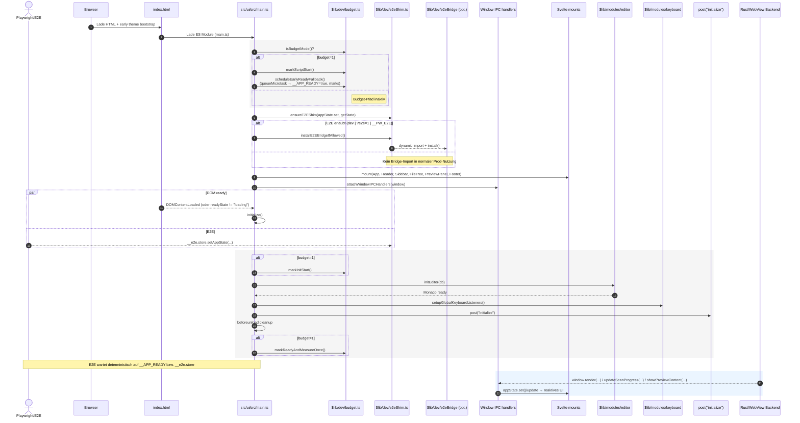

# CI Budgets (Step 4.5)

This project enforces **bundle** and **runtime** budgets in CI.

## Bundle budgets

`src/ui/scripts/check-budgets.mjs` (`npm run budget:bundle`) puts every built JS/CSS asset into exactly one category and checks the Brotli total of each:

- **INITIAL** – what the page loads before it can start: everything `dist/index.html` references (entry script, `modulepreload` links, stylesheets) plus the transitive static imports of those scripts.
- **LAZY** – all other non-worker chunks, fetched on demand through `import()` (Monaco and its language modes).
- **WORKERS** – `*.worker*.js` (only Monaco's base `editor.worker`; language workers are not shipped).

**Defaults (Brotli, in bytes; 1 kB = 1000 bytes):**

- INITIAL ≤ **150 000** (150 kB)
- LAZY total ≤ **1 000 000** (1.0 MB)
- WORKERS total ≤ **70 000** (70 kB) – about 20 % above the base editor worker (about 58 300); any language worker coming back fails it

The report prints the exact byte counts and, for readability, sizes in binary units (1 KiB = 1024 bytes).

A chunk that the entry imports statically counts as INITIAL, whatever its name: importing Monaco eagerly puts about 660 kB onto the initial load and fails the budget.

The limits live in the script; override them for an experiment via environment variables (bytes):

```bash
INITIAL_BROTLI=150000
LAZY_TOTAL_BROTLI=1000000
WORKER_TOTAL_BROTLI=70000
```

## Runtime budgets (E2E)

E2E tests under `src/ui/e2e/budgets.spec.ts` verify (Chromium only – the thresholds are calibrated for it):

1. **First mount time** – measured by `performance.measure('app-init')` in `main.ts` when `?budget=1` is present.
2. **Virtualization smoothness** – with a 25k item file tree, we assert the virtualized DOM rows are ≤ 600 (structural proxy for smoothness).

Env overrides:

- `BUDGET_INIT_MS` (default **1500** ms)
- `BUDGET_VTREE_MS` (default **3000** ms)

> Local runs on Apple Silicon can use stricter values, e.g.
> `BUDGET_INIT_MS=200 npm run test:e2e:budgets`

## How to run locally

```bash
cd src/ui
npm ci
npm run build
npm run budget:bundle

# E2E budget tests (use the same Playwright setup)
npx playwright install --with-deps chromium
npm run test:e2e:budgets
```

## Boot-Sequenz (Mermaid)


